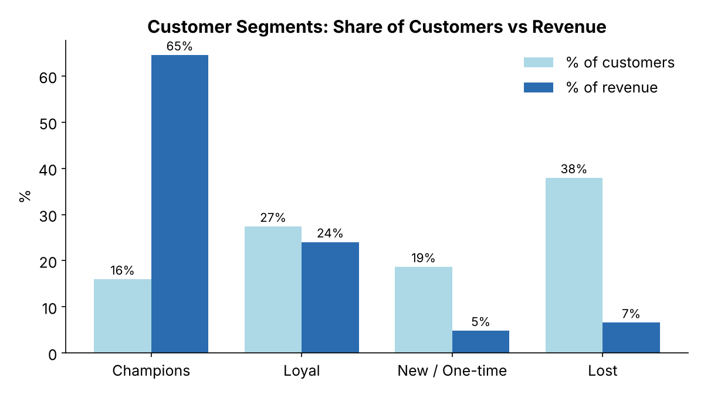
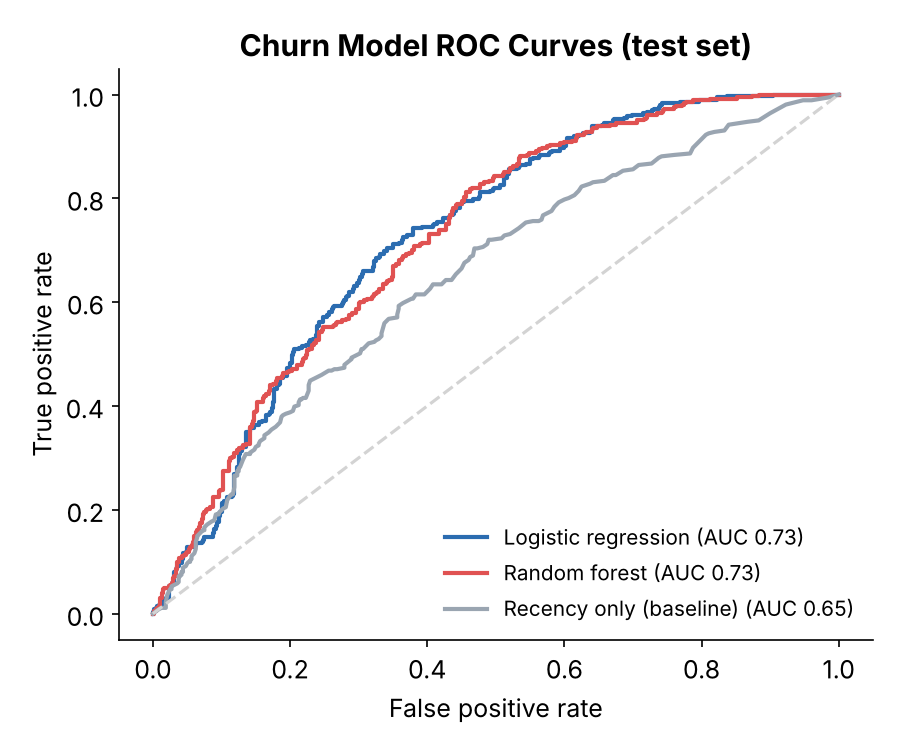

# UK Online Retail: Customer Analytics, Churn Prediction & Segmentation

End-to-end customer analytics for a UK online gift wholesaler: data cleaning, SQL analysis, hypothesis testing, RFM segmentation, a **leak-free churn model**, and a Power BI dashboard with business requirements (BRD and Jira).

**Tools:** Python (pandas, SciPy, scikit-learn), SQL (SQLite window functions and CTEs), Power BI, Confluence, Jira
**Methods:** Welch's t-test, Mann-Whitney U, K-Means clustering, logistic regression, random forest, cross-validation

📓 [Notebook](notebooks/uk_retail_customer_analytics.ipynb) · 🗄️ [SQL queries](sql/) · 📊 [Dashboard](dashboard/) · 📄 [Business requirements](docs/) · 🔗 [Kaggle version](https://www.kaggle.com/code/igormlopes/uk-online-retail-customer-analytics-churn-segmt)

---

## Business questions
1. Where does revenue come from: which months, markets and customers?
2. Which customers are likely to stop buying, and what predicts it?
3. Which customer segments should retention efforts target?

## Key results

| | |
|---|---|
| Revenue (cleaned) | **£8.61M** from 18,369 orders, 4,327 customers, 37 countries (Dec 2010 – Dec 2011) |
| Revenue concentration | **26%** of customers generate 80% of revenue |
| Seasonality | Sep–Nov revenue **66–101% above** the Jan–Aug monthly average |
| International orders | Median **£382 vs £293** for UK orders (Mann-Whitney p < 0.001) |
| Market risk | One customer generates **98%** of Netherlands revenue and **90%** of Australia revenue |
| Churn model | **ROC-AUC 0.73** on held-out customers (CV 0.75) vs 0.65 for recency alone |

<p align="center">
  
  
</p>

### Customer segments (RFM + K-Means)

| Segment | Customers | Revenue share | Profile | Recommended action |
|---|---|---|---|---|
| Champions | 16% | **65%** | Ordered in the last ~week, ~10 orders | VIP programme, account management |
| Loyal | 27% | 24% | Regular repeat buyers | Loyalty incentives to move up to Champions |
| New / One-time | 19% | 5% | Recent first or second order | Onboarding to secure a second order within 90 days |
| Lost | 38% | 7% | One order ~6 months ago | Low-cost win-back only |

### Churn prediction without target leakage
A common shortcut is to define churn as "no purchase in 90 days" and then feed recency into the model. The model just rediscovers the rule and scores ~100%. This project splits the timeline instead:
- **Features** use only purchases before **11 Sep 2011**: recency, frequency, spend, tenure, product variety, average order value, country.
- **Label:** *churned* means no purchase in the **following 90 days**. The churn rate is 43% of 3,361 customers.

Logistic regression and a random forest both reach **AUC ≈ 0.73** (cross-validated 0.75). At the default threshold, the model catches **73% of churners** with 60% precision. Order frequency, spend and recency drive the predictions. Customers with more past orders are much less likely to churn, so winning the second order is the key retention lever.

## Recommendations
1. **Protect the Champions.** 16% of customers drive 65% of revenue.
2. **Win the second order.** Convert one-time buyers within 90 days.
3. **Use the churn score** to target Loyal customers before they go dormant.
4. **Plan for Q4.** Prepare stock and staffing for the September–November surge.
5. **Diversify international accounts.** Several markets depend on one or two buyers.

## SQL
The [`sql/`](sql/) folder holds the queries run in the notebook against the cleaned data in SQLite:
- `monthly_revenue_growth.sql`: month-over-month growth with `LAG()`
- `top_customers_by_country.sql`: top 3 customers in each of the 5 largest international markets with CTEs, `RANK()` and share of country revenue
- `customer_rfm.sql`: recency, frequency and monetary features per customer

## Dashboard and business analysis
The analysis was turned into a stakeholder deliverable:
- **[Power BI dashboard](dashboard/powerbi_dashboard.png):** revenue KPIs, revenue by country, monthly trend, customer segments
- **[Business Requirements Document](docs/business_requirements_document.pdf):** stakeholders, scope, functional requirements, user stories, acceptance criteria
- **[Jira epic BAP-1](docs/jira_epic_BAP-1.pdf):** backlog of 7 user stories

The notebook exports [`outputs/customer_segments.csv`](outputs/) (segment and churn probability per customer), `monthly_revenue.csv` and `revenue_by_country.csv` as the dashboard's data source.

## Data
[Online Retail dataset](https://www.kaggle.com/datasets/carrie1/ecommerce-data) (UCI Machine Learning Repository). It has 541,909 invoice lines from a UK-based online retailer, Dec 2010 – Dec 2011. Cleaning removes cancelled invoices, invalid quantities and prices, guest checkouts without a customer ID, and the top 1% of unit prices, leaving 394,150 lines.

The data is **not included**. Download `data.csv` from Kaggle into `data/` to run the notebook, or open the Kaggle version.

## Repository structure
```
├── README.md
├── notebooks/uk_retail_customer_analytics.ipynb   # full analysis
├── sql/                                           # SQL queries (SQLite)
├── figures/                                       # charts generated by the notebook
├── outputs/                                       # customer segments + churn scores for Power BI
├── dashboard/powerbi_dashboard.png
├── docs/                                          # BRD and Jira epic
├── data/                                          # place data.csv here (not tracked)
└── requirements.txt
```

## How to run
```bash
pip install -r requirements.txt
# download data.csv into data/
jupyter notebook notebooks/uk_retail_customer_analytics.ipynb
```

---
**Igor M. Lopes**, CAPM® · MS Business Analytics & Project Management, University of Connecticut · [LinkedIn](https://linkedin.com/in/usbr-igorlopes) · [Kaggle](https://www.kaggle.com/igormlopes)
